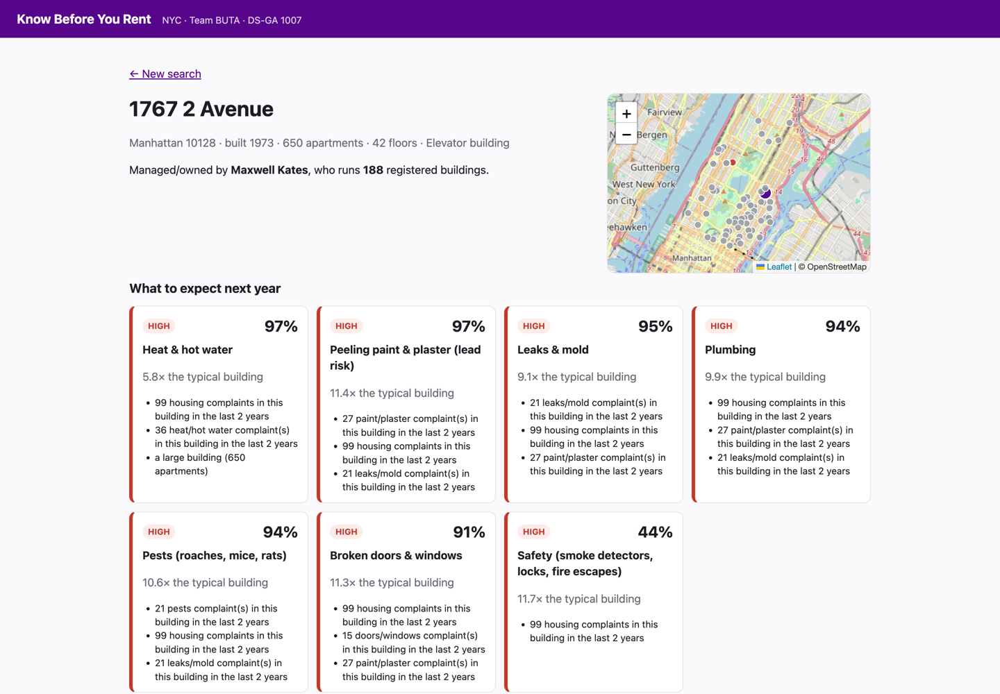

# The 100-Meter Inequality: Know Before You Rent

**Team BUTA** · DS-GA 1007 Programming for Data Science · NYU · Fall 2026

> Does living across the street change your NYC experience?

City and borough averages hide sharp local differences: two apartment buildings 100 meters apart can have very different heat, pest, leak and safety problems. This project measures those gaps using NYC open data, explains them, and turns them into a prediction a renter can use before signing a lease.



## What we found
Covering 172,546 NYC apartment buildings (3+ units), January 2022 to November 2026:

- **Problems repeat.** A building that had a problem in 2022–23 was **11–15× more likely** to have it again in 2024.
- **The landlord explains much of the 100-meter gap.** Take similar buildings within 100 m of each other: when one has a problem, a neighbor with the **same landlord** has it too **2.7–3.1× more often** than a neighbor with a different landlord.
- **Building age and the block matter.** Buildings from 1920–59 have the highest rates. Buildings in the busiest 100 m surroundings are 3–4× more likely to get a problem, even with a clean history.
- **Next year's problems are predictable.** Models trained on 2024 and tested on 2025 reach **AUC 0.89–0.93** for all seven problem types. The "it happened before" rule reaches 0.70–0.83.

## The product
A web app: type an NYC address and get the building's report:
- Its risk for 7 problem types next year, with plain-English reasons.
- Red flags: open hazardous violations, lead, bedbugs, evictions.
- Its complaint history.
- How the landlord's other buildings compare with NYC.
- Reported crime nearby.
- A map of the landlord's nearby buildings.

A second page charts the datasets, the findings and the model evaluation.

## Repository
| Folder | What's inside |
|---|---|
| [`know-before-you-rent/`](know-before-you-rent/) | Data pipeline, analysis notebooks, models and the web app: start here |
| `know-before-you-rent/scrapped_ideas/` | An earlier direction we explored (weather sensitivity of 311 complaints), kept for reference |
| `Relevent Materials/` | Project brief and proposal slides |

**In progress:** *City response times*, a model of how long NYC 311 service requests take to close. It will be added to this repository and integrated into the report and the app.

## Run it
```bash
cd know-before-you-rent
python3.13 -m venv .venv && source .venv/bin/activate
pip install -r requirements.txt
```
Then follow [`know-before-you-rent/README.md`](know-before-you-rent/README.md) to download the data, run the notebooks and start the app.

## Data
All data is public, from [NYC Open Data](https://opendata.cityofnewyork.us/):
- HPD housing complaints, violations and registrations
- PLUTO
- Bedbug reports
- Evictions
- NYPD complaints
- 311 service requests

The data is downloaded by the code and not stored in this repository.

## Team
Aditya Desai · Cavid Mammadzada · Nabi Shirinov · Ismayil Mirzə-Ağayev
